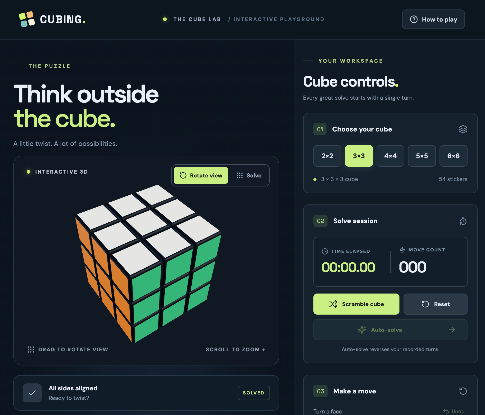

# Cubing

**[🎮 Play the simulator](https://hallojoe.github.io/cubing/)** · **[📖 Open the Learning Lab](https://hallojoe.github.io/cubing/#/learn)** · **[🧪 Open the Pro Lab](https://hallojoe.github.io/cubing/#/pro)**

An interactive 3D Rubik's Cube playground using React, Three.js, React Three Fiber, and Vite.



## Features

- 2×2 to 11×11 cubes with logically correct face and inner-layer turns
- Ctrl+Space switches view and solve modes; Solve uses csTimer's QWERTY virtual-cube keyboard layout
- Separate Rotate view and Solve modes: orbit and zoom without accidental turns, or lock the camera to drag stickers in the desired turn direction; face controls, reverse and half turns
- Smooth 240ms quarter-turn and 340ms half-turn animations for manual moves, undo, and auto-solve (layer stays visually connected while rotating)
- Scrambling, timed solve sessions, move counting, undo, reset, solved-state detection
- Automated move-history reversal to recover a solved state
- Filled or wireframe display, four color palettes (Classic Rubik's, Pastel, Neon, Mono)
- Responsive dark interface

## Learning Lab

A separate guided learning page lives at `#/learn` (works when refreshed on GitHub Pages). The existing simulator remains at the root.

1. **Choose your cube:** 2×2 through 11×11.
2. **Choose an algorithm:** right and left triggers, Sexy Move, Sledgehammer, Sune, Anti-Sune, or OLL cross (Sune / Anti-Sune include 2×2; OLL Cross requires edges and is hidden on 2×2).
3. **Walk through the moves:** every move is listed with noninteractive, isometric 3D before/after previews. Click any move to animate the main Three.js cube forward or backward from its current lesson step. Use the transport controls to navigate one move at a time or jump to start/end.

The lesson begins from a solved reference cube and demonstrates **algorithm drills**, not a full solve for an arbitrary scrambled cube. The main teaching cube can be orbited to inspect each turn; previews are static snapshots.

On 4×4–11×11, solving use requires solved centers and fully paired edge groups (reduction). These outer-turn lessons do not build centers, pair edges, or fix parity. Read the [algorithm applicability audit](docs/algorithm-audit.md) for the size matrix, rationale, sources, and verification.

## Pro Lab

A separate `#/pro` page is built for experienced cubers who want to investigate how algorithms work:

- Six study topics: commutators / conjugates, PLL recognition, F2L lookahead, 2×2 CLL / EG, 4×4 PLL parity, and big-cube reduction / edge orbits. Topics and presets filter by actual applicability.
- Editable sequence, commutator `[A, B]`, and conjugate `[A: B]` construction, with expanded notation and explicit validation.
- Wide turns, numbered inner slices, whole-cube rotations, and unambiguous odd-cube middle slices. A wide turn animates all its layers together.
- **Case → solved** constructs the exact inverse setup; **Solved → effect** exposes the algorithm's net effect.
- Animated forward/backward seeking, pause after the current turn, playback speed, clickable moves, fixed six-face inspection, changed-piece counts, and static start/finish previews.
- Prerequisites, investigations, and links to primary teaching sources for each topic. This is an experiment workbench and focused study guide, not a complete algorithm database or arbitrary-state solver.

The simulator's solve/rotate controls and the Learning Lab's wizard remain on their original routes.

## Run locally

```bash
npm install
npm run dev
```

Open the local URL reported by Vite. Verify changes using `npm test` and `npm run build`.

## Playing

Choose a size, press **Scramble cube**, then select **Rotate view** to drag/orbit the camera and scroll to zoom, or **Solve** to lock the camera and **drag a sticker horizontally or vertically** to rotate its row or column in that direction. The swiped sticker determines the layer, including inner layers on 4×4–11×11. U/D/L/R/F/B face buttons work in either mode. A short tap does not turn the puzzle. Drag direction is interpreted relative to the camera view. Use face buttons for explicit clockwise or reverse turns. The **Layer depth** control applies to the U/D/L/R/F/B face buttons; dragging selects the slice under your finger automatically. The clock starts on the first user move and stops when the cube becomes solved; move count excludes scrambling and auto-solve.

**Keyboard:** In Solve mode, use csTimer's default keyboard mappings: J=U, F=U′, I=R, K=R′, H=F, G=F′, S=D, L=D′, D=L, E=L′, W=B, O=B′. Wide turns, middle slices, and x/y/z rotations are also mapped. Each keypress counts as one move, including compound moves, which animate their slices sequentially. Input uses physical key positions via KeyboardEvent.code.

**Auto-solve design:** This version reverses the recorded move history, so it correctly restores any state reached through this simulator (including scrambles and inner-layer turns). It is **not** a general solver for independently entered cube states. That would require an additional solving algorithm, especially for 4×4–11×11.

Sticker swipes use pointer capture for mouse and touch and select a single slice once the drag crosses a movement threshold. Camera rotation remains disabled in Solve mode. Manual turns, undo and auto-solve animate the selected layer before committing its updated sticker positions. Input is temporarily locked during each move to avoid overlapping turns; auto-solve runs its queued inverse moves in order.

The pure cube model is implemented in `src/cube.ts`; React Three Fiber draws the model in `src/App.tsx`. The model invariant tests in `src/cube.test.ts` cover sizes 2–11.

## Publishing on GitHub Pages

This project is configured for the default GitHub Pages URL:
**https://hallojoe.github.io/cubing/**

1. In the GitHub repository, open **Settings → Pages**.
2. Under **Build and deployment**, set **Source** to **GitHub Actions** (not *Deploy from a branch*).
3. Merge the GitHub Pages deployment pull request into `main`. The deployment workflow runs automatically on a push to `main`, or you can run it from the **Actions** tab using **Run workflow**.
4. Check **Actions → Deploy Cubing to GitHub Pages** for a successful deployment, then open the site URL above.

The deployment action installs dependencies, builds the Vite app into `dist`, and publishes it. Vite uses `/cubing/` as the production asset base so JavaScript, CSS, and other assets load from the repository subpath. Local development continues to use `/`.

**Note:** If you move to a custom domain or rename the repository, update the production `base` in `vite.config.ts` accordingly.

